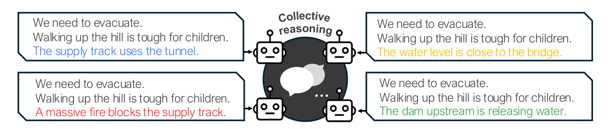
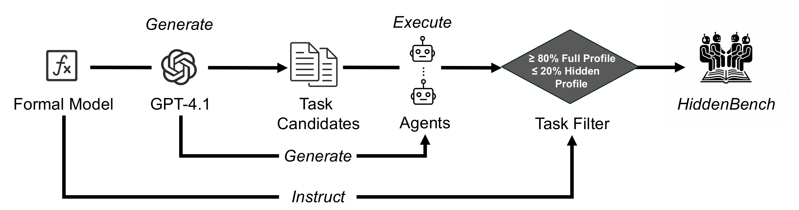
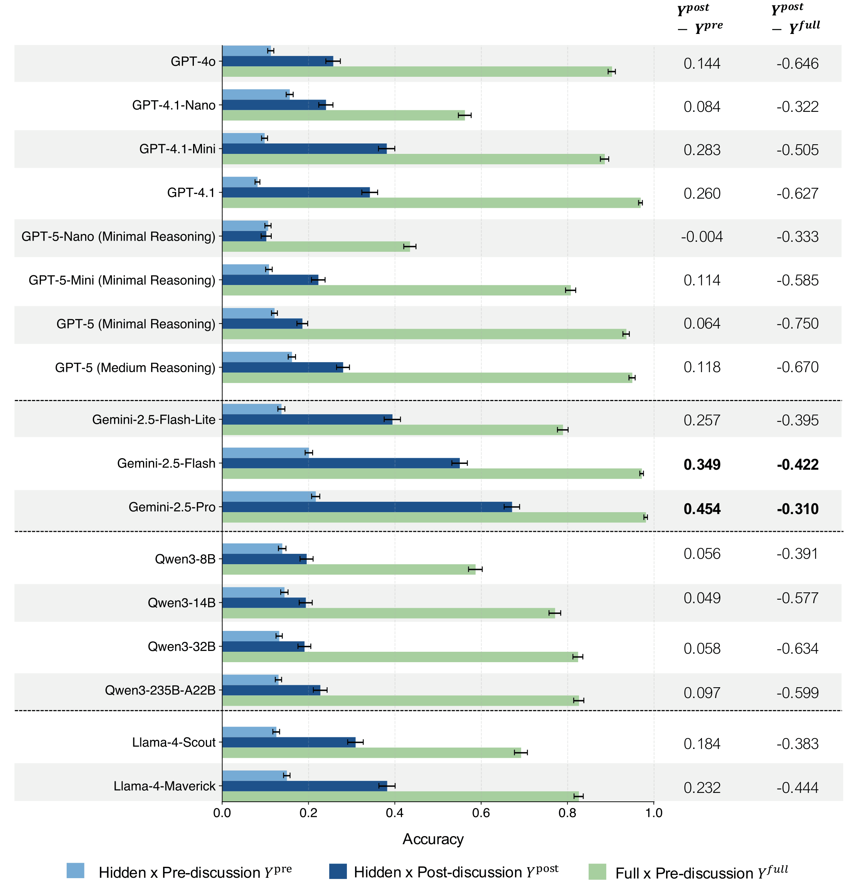

# HiddenBench

**HiddenBench** is a benchmark and evaluation toolkit for testing whether multi-agent LLM systems can solve group decisions when critical information is distributed across agents.

The benchmark accompanies the ICML 2026 paper **Systematic Failures in Collective Reasoning under Distributed Information in Multi-Agent LLMs**. It contains 65 Hidden Profile tasks designed to separate individual reasoning ability from collective information sharing.



## Why HiddenBench?

Multi-agent LLM systems are often expected to outperform a single model by pooling diverse information. HiddenBench tests that assumption directly:

| Condition | What agents see | What it measures |
| --- | --- | --- |
| Hidden Profile | Shared facts plus one private hidden fact per agent | Whether agents can elicit and integrate distributed information |
| Full Profile | Every agent sees all shared and hidden facts | Whether the task is individually solvable with complete information |

In the ICML paper, frontier LLM groups reached only **30.1%** accuracy under distributed information, compared with **80.7%** for single agents given complete information.

## Install

```bash
git clone https://github.com/Yassellee/HiddenBench.git
cd HiddenBench
python -m venv .venv
source .venv/bin/activate
pip install -e ".[dev]"
```

For Hugging Face loading:

```bash
pip install -e ".[hf]"
```

Set the API key for your provider:

```bash
export OPENAI_API_KEY=...
```

## Quickstart

Inspect one of the three paper verification tasks:

```bash
hiddenbench inspect --benchmark data/benchmark_short.json --task-id 2
```

Run GPT-4.1 on the short benchmark under distributed information:

```bash
hiddenbench eval \
  --benchmark data/benchmark_short.json \
  --profile hidden \
  --model gpt-4.1 \
  --provider openai \
  --rounds 15 \
  --duplications 1 \
  --seed 2026 \
  --max-workers 1 \
  --output runs/gpt41_hidden_short.json
```

Score the result:

```bash
hiddenbench score runs/gpt41_hidden_short.json --benchmark data/benchmark_short.json
```

Run the full-profile comparison:

```bash
hiddenbench eval \
  --benchmark data/benchmark_short.json \
  --profile full \
  --model gpt-4.1 \
  --provider openai \
  --rounds 15 \
  --duplications 1 \
  --seed 2026 \
  --max-workers 1 \
  --output runs/gpt41_full_short.json

hiddenbench score runs/gpt41_hidden_short.json \
  --benchmark data/benchmark_short.json \
  --full-results runs/gpt41_full_short.json
```

## Hugging Face Dataset

The raw benchmark is also available on Hugging Face:

```bash
hiddenbench eval \
  --hf YuxuanLi1225/HiddenBench \
  --profile full \
  --model gpt-4.1 \
  --provider openai \
  --output runs/gpt41_full_hf.json
```

Python:

```python
from hiddenbench import load_benchmark

tasks = load_benchmark(source="hf", hf_repo="YuxuanLi1225/HiddenBench")
print(len(tasks))
```

## Discussion and Vote Result Files

We also provide the generated discussion and vote JSON files so researchers can audit transcripts, recompute metrics, or study failure modes directly. They are hosted as a public Hugging Face dataset: [YuxuanLi1225/HiddenBench-results](https://huggingface.co/datasets/YuxuanLi1225/HiddenBench-results).

Result layout:

```text
MANIFEST.json
README.md
hiddenbench-results-json.zip
paper/
  hidden_manual_adapted/  # hidden-profile runs for 8 manual/adapted tasks
  hidden_generated/       # hidden-profile runs for 57 generated tasks
  full_profile/           # full-profile runs for all 65 tasks
short_and_ablations/
```

Download the ZIP and analyze:

```bash
hf download YuxuanLi1225/HiddenBench-results hiddenbench-results-json.zip \
  --repo-type dataset \
  --local-dir .
unzip hiddenbench-results-json.zip

hiddenbench score \
  results/paper/hidden_manual_adapted/hidden_manual_adapted_gpt-4.1.json \
  results/paper/hidden_generated/hidden_generated_gpt-4.1.json \
  --benchmark data/benchmark.json \
  --full-results results/paper/full_profile/full_profile_gpt-4.1.json
```

The ZIP expands to:

```text
results/
  MANIFEST.json
  paper/
    hidden_manual_adapted/  # hidden-profile runs for 8 manual/adapted tasks
    hidden_generated/       # hidden-profile runs for 57 generated tasks
    full_profile/           # full-profile runs for all 65 tasks
  short_and_ablations/
```

See [docs/results.md](docs/results.md) for the result layout and analysis examples.

## Evaluate a New Model

For OpenAI-compatible APIs:

```bash
hiddenbench eval \
  --benchmark data/benchmark_short.json \
  --profile hidden \
  --provider openai-compatible \
  --base-url https://your-provider.example/v1 \
  --api-key-env YOUR_PROVIDER_API_KEY \
  --model your-model-name \
  --output runs/your_model_hidden_short.json
```

For a custom Python integration, implement the small `ModelClient` interface:

```python
from hiddenbench import load_benchmark, run_evaluation, score_results

class MyModel:
    model_name = "my-model"

    def chat(self, messages):
        return call_my_model(messages)

    def chat_json(self, messages, schema):
        return call_my_model_for_json(messages, schema)

tasks = load_benchmark(path="data/benchmark_short.json")
results = run_evaluation(tasks, MyModel(), profile="hidden", rounds=15, seed=2026)
scores = score_results(results, tasks)
print(scores["average_accuracy"])
```

See [examples/custom_model.py](examples/custom_model.py) for a runnable mocked example.

## Task Generation

HiddenBench includes a reproducible task generation and validation workflow. Candidate tasks pass validation when initial pre-discussion accuracy is high in the Full Profile condition and low in the Hidden Profile condition.

```bash
hiddenbench generate-tasks \
  --provider openai \
  --model gpt-4.1 \
  --num-candidates 200 \
  --full-min-accuracy 0.8 \
  --hidden-max-accuracy 0.2 \
  --output runs/generated_tasks.json
```



## Files

```text
data/
  benchmark.json          # 65-task HiddenBench benchmark
  benchmark_short.json    # 3 verification tasks from the paper
  benchmark_player5.json  # optional larger-group tasks
  benchmark_player6.json
  benchmark_player7.json
src/hiddenbench/
  benchmark.py            # dataset loading and validation
  models.py               # model adapters
  simulator.py            # multi-agent protocol
  metrics.py              # scoring
  generation.py           # task generation and validation
```

## Metrics

HiddenBench reports:

- **Pre-discussion average accuracy**: fraction of individual agents initially selecting the correct answer.
- **Post-discussion average accuracy**: fraction of individual agents selecting the correct answer after discussion.
- **Majority accuracy**: whether a strict majority of agents selects the correct answer.
- **Improvement**: post-discussion minus pre-discussion accuracy.
- **Gap to full profile**: hidden-profile post-discussion accuracy minus full-profile pre-discussion accuracy.



## Citation

```bibtex
@article{li2025hiddenbench,
  title={HiddenBench: Assessing Collective Reasoning in Multi-Agent LLMs via Hidden Profile Tasks},
  author={Li, Yuxuan and Naito, Aoi and Shirado, Hirokazu},
  journal={arXiv preprint arXiv:2505.11556},
  year={2025}
}
```

## License

HiddenBench is released under the MIT License.
